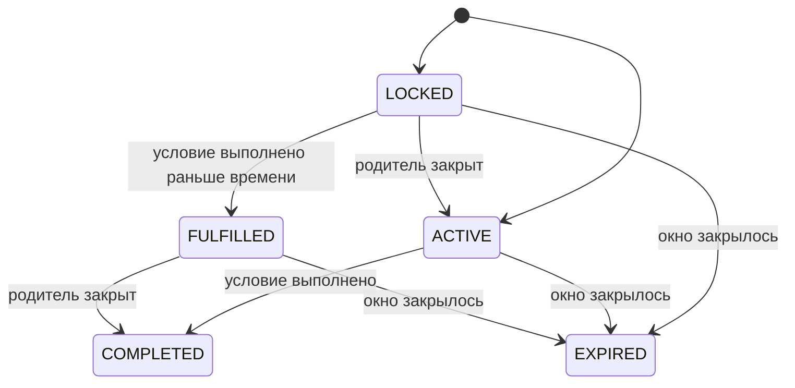

# CHANGELOG: 27 Октября 2026 (proto `v0.3.31` → `v0.3.32`)

Новый модуль **«Быстрый старт»** (`quick_start`, Welcome Road): онбординг-задачи для
нового дистрибьютора с наградой в WinTime за каждую закрытую задачу и финальным бонусом
за все задачи в окне (на проде 24 часа от регистрации). Пара к ядру `1.10.42`.

Что входит:

- два новых сервиса — клиентский `QuickStartService` и админский `QuickStartAdminService`;
- общие модели `biconom.types.QuickStart`;
- две новые карточки истории кошелька — `quick_start_task_reward` и
  `quick_start_completion_bonus`;
- новый топик уведомлений `TOPIC_QUICK_START_REWARDED`.

> ✅ **Не breaking.** Новые пакеты, сервисы и сообщения; два новых варианта в `oneof
> details` транзакции (номера `34` и `35`) и одно новое значение enum `Topic` (`23`).
> Ничего не удалено и не перенумеровано. Старые клиенты новые поля игнорируют.

> ℹ️ **Программа включается флагом в YAML ядра** (`quick_start.enabled`), на staging и
> проде — отдельно. Пока она
> выключена, `QuickStartService.Get` отдаёт `State.status = STATUS_UNAVAILABLE` без
> задач, а новых проводок и уведомлений нет. На момент подготовки релиза в
> `config.prod.yaml` программа выключена. Фронту нужно обработать обе новые карточки
> истории и новый топик настроек **до** включения программы в проде.

## Что нужно сделать фронту — коротко

| Действие | Где подробно |
|---|---|
| Перегенерировать клиент из `.proto` | — |
| Раздел «Быстрый старт»: `Get` → карточки из `State.tasks` в присланном порядке, тексты по `task.code`, отсчёт до `deadline_at` | §2 |
| Чаты Telegram: кнопки из `TaskProgress.chats`, после возврата из Telegram — `CheckTelegramMembership`, затем опрос `Get` каждые 2–3 с, пока `last_check.status == PENDING`; не раньше `next_allowed_at` | §2 |
| История кошелька: две новые карточки `quick_start_task_reward`, `quick_start_completion_bonus` | §3 |
| Настройки уведомлений: подпись и переключатели для `TOPIC_QUICK_START_REWARDED` | §4 |

## Что нужно сделать админке — коротко

| Действие | Где подробно |
|---|---|
| Экран «Быстрый старт» (ROOT): программа, шаблон задач (создание / правка / архив / удаление) | §5 |
| Кнопка «Засчитать вручную» в карточке дистрибьютора (поддержка; причина обязательна) | §5 |
| Воронка: `GetStats` | §5 |
| В форме правки показывать, что структурные поля заблокированы, когда по задаче есть прогресс | §5 |

## Основные правила (для экранов)

Подробно — [`biconom/types/quick_start.md`](biconom/types/quick_start.md).

- **Окно** — от регистрации дистрибьютора, `State.deadline_at`. Условие, наблюдённое
  после дедлайна, не засчитывается.
- **Условия выполняются в любом порядке.** Выполнение фиксируется сразу
  (`STATUS_FULFILLED`) и не снимается, даже если пользователь отменил действие.
- **Награда выплачивается, только когда задача открыта** — её родитель закрыт или
  родителя нет. Выполненная, но закрытая задача ждёт в `FULFILLED`.
- **Каскад.** Закрытие задачи открывает детей; если их условия уже выполнены, они
  закрываются тут же — одним обновлением может прийти несколько наград.
- **Финальный бонус** — один раз на дистрибьютора, за закрытие **всех неархивных** задач
  в окне. Тогда `State.status = STATUS_COMPLETED`. При `completion_bonus = 0` статус
  тот же, но бонус не начисляется (ни проводки, ни уведомления).
- **Архивные задачи** новым участникам не показываются; закрывшие их — продолжают видеть.
- **Один Telegram-аккаунт — один дистрибьютор.** Повторно использовать уже засчитанный
  Telegram нельзя (`State.telegram = TELEGRAM_STATUS_ALREADY_USED`).
- **Награды приходят сами**, кнопки «получить» нет: на привязке Telegram, загрузке
  аватарки, регистрации личника и на вступлении в чат (бот видит вступления в реальном
  времени). `CheckTelegramMembership` — запасной путь.
- **Все суммы WinTime — строки**, целые токены.



## 1. Новые модели `biconom.types.QuickStart`

### `biconom/types/quick_start.proto`

```protobuf
message QuickStart {
    enum ConditionKind {
        CONDITION_KIND_UNSPECIFIED = 0;
        CONDITION_KIND_TELEGRAM_LINKED = 1;   // привязан собственный Telegram
        CONDITION_KIND_TELEGRAM_CHANNEL = 2;  // состоит в ЛЮБОМ канале из YAML-списка
        CONDITION_KIND_TELEGRAM_GROUP = 3;    // состоит в ЛЮБОЙ группе из YAML-списка
        CONDITION_KIND_AVATAR = 4;            // загружена аватарка профиля
        CONDITION_KIND_REFERRAL = 5;          // >= Task.condition_count личников после начала окна
    }

    message Task {
        message Id   { uint32 id = 1; }
        message List { repeated Task items = 1; }
        enum Status { STATUS_UNSPECIFIED = 0; STATUS_ACTIVE = 1; STATUS_ARCHIVED = 2; }

        uint32 id = 1;
        uint32 parent_id = 2;          // 0 — корень
        string code = 3;               // slug для фронта, [a-z0-9_]
        ConditionKind condition = 4;
        uint32 condition_count = 5;    // для REFERRAL >= 1, иначе 0
        string reward = 6;             // WinTime, строка
        uint32 position = 7;
        Status status = 8;
    }

    message TelegramChat {
        message Id { int64 id = 1; }
        int64 id = 1;                  // Telegram chat_id, отрицательный (-100…)
        string language = 2;           // ISO 639-1
        string title = 3;
        string url = 4;                // https://t.me/...
    }

    enum TelegramStatus {
        TELEGRAM_STATUS_UNSPECIFIED = 0;
        TELEGRAM_STATUS_NOT_LINKED = 1;
        TELEGRAM_STATUS_LINKED = 2;
        TELEGRAM_STATUS_ALREADY_USED = 3;
    }

    message TelegramCheck {
        enum Status { STATUS_UNSPECIFIED = 0; STATUS_PENDING = 1; STATUS_MEMBER = 2;
                      STATUS_NOT_MEMBER = 3; STATUS_FAILED = 4; }
        int64 chat_id = 1;
        Status status = 2;
        google.protobuf.Timestamp checked_at = 3;
        google.protobuf.Timestamp next_allowed_at = 4;
    }

    message TaskProgress {
        enum Status { STATUS_UNSPECIFIED = 0; STATUS_LOCKED = 1; STATUS_ACTIVE = 2;
                      STATUS_FULFILLED = 3; STATUS_COMPLETED = 4; STATUS_EXPIRED = 5; }
        Task task = 1;
        Status status = 2;
        google.protobuf.Timestamp fulfilled_at = 3;
        google.protobuf.Timestamp completed_at = 4;
        repeated TelegramChat chats = 5;     // только для задач канала / группы
        int64 fulfilled_chat_id = 6;         // 0 — не засчитано чатом
        optional TelegramCheck last_check = 7;
        uint32 progress = 8;                 // REFERRAL: личников из condition_count; иначе 0/1
    }

    message State {
        enum Status { STATUS_UNSPECIFIED = 0; STATUS_ACTIVE = 1; STATUS_COMPLETED = 2;
                      STATUS_EXPIRED = 3; STATUS_UNAVAILABLE = 4; }
        Status status = 1;
        google.protobuf.Timestamp deadline_at = 2;
        repeated TaskProgress tasks = 3;     // обход дерева в глубину по (position, id)
        string completion_bonus = 4;
        google.protobuf.Timestamp completed_at = 5;
        TelegramStatus telegram = 6;
    }
}
```

Все значения enum — append-only. Подробно — [`biconom/types/quick_start.md`](biconom/types/quick_start.md).

## 2. Клиент: `QuickStartService`

### `biconom/client/quick_start/quick_start.proto`

```protobuf
service QuickStartService {
    rpc Get(google.protobuf.Empty) returns (biconom.types.QuickStart.State);
    rpc CheckTelegramMembership(biconom.types.QuickStart.TelegramChat.Id)
        returns (biconom.types.QuickStart.TelegramCheck);
}
```

Дистрибьютор — из контекста авторизации. Нужен обычный `Session`-токен пользователя,
**отдельного права не требуется**: раздел доступен всем. Гость — `Unauthenticated`
(`GUEST_ACCESS_DENIED`), сессия без дистрибьютора — `PermissionDenied`
(`ACCESS_SCOPE_DENIED`).

### Как фронту использовать

1. `Get` → по `State.status`: `ACTIVE` — карточки и отсчёт; `COMPLETED` — «пройдено»;
   `EXPIRED` — закрытые задачи, остальные «время вышло»; `UNAVAILABLE` — раздел скрыть.
2. **Карточки — из `State.tasks` в присланном порядке** (обход дерева в глубину).
3. **Тексты и иконки — по `task.code`**. Известные коды: `telegram_connect`,
   `telegram_channel`, `telegram_group`, `profile_avatar`, `invite_friend`. Для
   неизвестного кода нужна запасная карточка.
4. **Отсчёт** — до `deadline_at`; на нуле перезапросить `Get`.
5. **Прогресс**: `invite_friend` — `progress` из `task.condition_count`; остальные —
   `0` / `1`.
6. **Чаты**: кнопки из `TaskProgress.chats` (`url` — ссылка-приглашение). Условие
   засчитывается за вступление в **любой** из чатов задачи.
7. После возврата пользователя из Telegram: `CheckTelegramMembership({ id: chat.id })` →
   `PENDING` → **опрос `Get` каждые 2–3 с, пока `last_check.status == PENDING`**. Итог:
   `MEMBER` (задача станет `FULFILLED` / `COMPLETED`), `NOT_MEMBER`, `FAILED`.
8. **Не вызывать проверку раньше `next_allowed_at`** — иначе
   `QUICK_START_CHECK_TOO_FREQUENT`. Кулдаун — на каждый чат отдельно.
9. `State.telegram`: `NOT_LINKED` — предложить привязать Telegram; `ALREADY_USED` —
   сообщить, что этот Telegram уже использован, проверку не предлагать.
10. **Опрос остановить**, когда `last_check` пропал (задача стала `FULFILLED` /
    `COMPLETED` — у них `last_check` не приходит) или его статус не `PENDING`. Плюс
    общий потолок ~30 с: журнал проверок живёт в памяти сервера и после его рестарта
    `PENDING` больше не придёт — тогда предложить проверить ещё раз.
11. **Засчитывание асинхронное.** После любого действия пользователя (привязал Telegram,
    загрузил аватарку, вернулся из канала) награда появляется не в ответе, а через
    1–2 с в следующем `Get`. При возвращении в приложение / на экран — перезапросить
    `Get` (и ещё раз через 2–3 с).
12. **`chat.id` — `int64`** (отрицательный, `-100…`, 13 цифр — в `Number` помещается без
    потерь). Передавать в `CheckTelegramMembership` ровно то значение, что пришло в
    `TaskProgress.chats[].id`; если генератор отдаёт `int64` строкой — строкой.
13. **Язык чатов.** В `TaskProgress.chats[].language` — ISO 639-1; чаты языка интерфейса
    показывать первыми, остальные — ниже (засчитывается любой).

### Экран по макету «Welcome Road / Quick Start»

**Шапка «Extra bonus».** Сумма — `State.completion_bonus` (если `"0"` — блок не
показывать). Полоса «N / M»: M — число задач, у которых `task.status != STATUS_ARCHIVED`;
N — сколько из них в `STATUS_COMPLETED`. Архивные задачи, закрытые раньше, в списке
видны, но в полосу и в условие бонуса не входят. Внизу — отсчёт до `deadline_at`
(«Осталось времени: 23 ч 56 мин»).

**Карточка задачи** — справа «Награда» = `task.reward`. Вид и кнопка — по статусу:

| `TaskProgress.status` | Что показать |
|---|---|
| `LOCKED` | Плашка «Чтобы увидеть задание, выполните предыдущее», сумма награды видна, кнопки нет |
| `ACTIVE` | Текст задачи + кнопка действия (таблица ниже) |
| `FULFILLED` | Зелёная отметка «Выполнено», подпись «награда придёт после предыдущего задания» |
| `COMPLETED` | Зелёная кнопка-плашка «Выполнено» (как на макете) |
| `EXPIRED` | Серая плашка «Время вышло» |

Кнопки действий по `task.code` — всё это существующие методы, новых нет:

| `task.code` | Кнопка | Что вызвать |
|---|---|---|
| `telegram_connect` | «Подключить Telegram» | `UserService.GetTelegramBotLink` → открыть ссылку на бота |
| `telegram_channel` | «Открыть в Telegram» у каждого чата | открыть `chats[].url`, после возврата — `CheckTelegramMembership` |
| `telegram_group` | «Открыть в Telegram» у каждого чата | то же |
| `profile_avatar` | «Загрузить фото» | `UserService.GetAvatarUploadUrl` → загрузка в хранилище изображений |
| `invite_friend` | «Пригласить» | своя реферальная ссылка (`InviteLinkService`); прогресс — `progress / condition_count` |
| любой другой | общая карточка без кнопки | — |

Все тексты (RU/EN) — на фронте по `task.code`; сервер текстов карточек не отдаёт.

### Ошибки `CheckTelegramMembership`

| Код | gRPC-статус | Когда |
|---|---|---|
| `QUICK_START_NOT_ACTIVE` | `FailedPrecondition` | Окно закрыто, программа выключена или прохождение уже завершено |
| `QUICK_START_TELEGRAM_NOT_LINKED` | `FailedPrecondition` | Telegram не привязан |
| `QUICK_START_TELEGRAM_ALREADY_USED` | `FailedPrecondition` | Этот Telegram уже засчитывал задачи другому дистрибьютору |
| `QUICK_START_ALREADY_FULFILLED` | `FailedPrecondition` | Условие задачи этого чата уже выполнено |
| `QUICK_START_CHAT_NOT_FOUND` | `NotFound` | Нет чата с таким `id` (или задачи его вида нет в шаблоне) |
| `QUICK_START_CHECK_TOO_FREQUENT` | `ResourceExhausted` | С прошлой проверки этого чата прошло меньше `check_cooldown` (на проде 30 с) — ждать `next_allowed_at`; **или очередь проверок сервера переполнена** — повторить через 2–3 с |
| `DISTRIBUTOR_NOT_FOUND` | `NotFound` | (и для `Get`) дистрибьютор сессии не найден — служебный случай |

Подробно — [`biconom/client/quick_start/quick_start.md`](biconom/client/quick_start/quick_start.md).

## 3. Карточки истории кошелька

### `biconom/types/transaction.proto`

```protobuf
// oneof details: ...без изменений...
//     StakingExtraIncomeDetails staking_extra_income = 33;
//     QuickStartTaskRewardDetails quick_start_task_reward = 34;
//     QuickStartCompletionBonusDetails quick_start_completion_bonus = 35;

// Награда WinTime «Быстрого старта» за закрытую задачу.
message QuickStartTaskRewardDetails {
    uint32 task_id = 1;     // QuickStart.Task.id
    string task_code = 2;   // QuickStart.Task.code (подставляется при извлечении)
}

// Финальный бонус: закрыты все неархивные задачи в пределах окна.
// Выплачивается один раз на дистрибьютора.
message QuickStartCompletionBonusDetails {
    uint32 completed_in_secs = 1;  // секунд от начала окна (регистрации) до последней задачи
}
```

Обе карточки приходят в `TransactionService.History` обычными `Entry`: сумма — в
`entry.amount` (WinTime, целые токены), зачисление.

| `details` | Иконка | Заголовок | Подзаголовок | Сумма |
|---|---|---|---|---|
| `quick_start_task_reward` | Подарок / «ракета», зелёная | `Quick Start` | Текст задачи по `task_code` (те же тексты, что на карточках раздела); для неизвестного кода — общий «Задание выполнено» | Зелёным, `+amount` |
| `quick_start_completion_bonus` | Кубок / звезда, зелёная | `Quick Start completed` | Время прохождения из `completed_in_secs` (например, «за 42 мин»; меньше минуты — «за считанные секунды») | Зелёным, `+amount` |

> Вид карточек — рекомендация, как в остальных разделах руководства по истории
> транзакций; обязательны только поля из proto выше.

Нюансы:

- Каскад приходит **несколькими карточками** — по одной на каждую закрытую задачу;
  финальный бонус — отдельной карточкой.
- Ручной зачёт поддержкой (`FulfillTask`) даёт ту же карточку `quick_start_task_reward`.

## 4. Новый топик уведомлений `TOPIC_QUICK_START_REWARDED`

### `biconom/client/notification_preferences/notification_preferences.proto`

```protobuf
enum Topic {
    // …
    TOPIC_STAKING_DEPOSIT_MATURED = 22;
    TOPIC_QUICK_START_REWARDED = 23;   // ← новое
}
```

Уведомление о награде «Быстрого старта»: закрыта задача онбординга или выплачен
финальный бонус. Каналы и значения по умолчанию **те же, что у `TOPIC_BONUS_RECEIVED`**:

| Канал | Политика |
|---|---|
| Telegram | `optional`, включён по умолчанию |
| Push | `optional`, включён по умолчанию |
| Email | запрещён политикой — переключателя быть не должно |

**Что нужно фронту.** В экране настроек уведомлений у нового топика должна быть подпись
(например, «Быстрый старт: награды») и два переключателя — Telegram и push. Строковое имя
топика в admin-API (`SetForUser.topic`) — `quick_start_rewarded`.

Одно уведомление на каждую выплаченную награду; при каскаде их может прийти несколько
подряд. Текст зависит от `task_code` (для финального бонуса — от времени прохождения).

## 5. Админка: `QuickStartAdminService`

### `biconom/admin/quick_start/quick_start.proto`

```protobuf
service QuickStartAdminService {
    rpc GetProgram(google.protobuf.Empty) returns (Program);
    rpc UpsertTask(biconom.types.QuickStart.Task) returns (biconom.types.QuickStart.Task);
    rpc DeleteTask(biconom.types.QuickStart.Task.Id) returns (google.protobuf.Empty);
    rpc FulfillTask(FulfillTaskRequest) returns (biconom.types.QuickStart.State);
    rpc GetDistributorState(biconom.types.Distributor.Id) returns (biconom.types.QuickStart.State);
    rpc GetStats(google.protobuf.Empty) returns (Stats);
}

message FulfillTaskRequest {
    biconom.types.Distributor.Id distributor = 1;
    uint32 task_id = 2;
    string reason = 3;   // обязательна; сохраняется в прогрессе и в примечании проводки
}

message Program {
    bool enabled = 1;
    uint32 duration_secs = 2;          // на проде 86400
    string completion_bonus = 3;       // WinTime
    uint32 check_cooldown_secs = 4;
    repeated biconom.types.QuickStart.TelegramChat channels = 5;
    repeated biconom.types.QuickStart.TelegramChat groups = 6;
    repeated biconom.types.QuickStart.Task tasks = 7;
}

message Stats {
    message TaskStats {
        uint32 task_id = 1;
        uint64 fulfilled = 2;   // FULFILLED + COMPLETED
        uint64 completed = 3;
        string rewarded = 4;
    }
    repeated TaskStats tasks = 1;
    uint64 active_windows = 2;
    uint64 completed_windows = 3;
    string completion_bonus_rewarded = 4;
}
```

**Права:** все методы — только `ROOT`.

**Что где редактируется.** Шаблон задач — через `UpsertTask` / `DeleteTask`. Параметры
программы и списки чатов — в YAML ядра, в админке **только чтение** (`GetProgram`).

**`UpsertTask`.** `id == 0` — создать (id назначает сервер), иначе обновить; обновление —
**полная замена полей**, нужно слать все. `status` и `position` меняются всегда, `code` —
если уникален. `parent_id`, `condition`, `condition_count`, `reward` **нельзя менять,
если по задаче у кого-то есть прогресс** (`QUICK_START_TASK_IN_USE`) — архивировать и
создать новую. Цепочка из пяти задач создаётся последовательно, каждая следующая
получает `parent_id` из ответа на предыдущий вызов.

**`FulfillTask`** (поддержка): засчитать условие вручную; причина обязательна; только
в пределах окна. Если задача открыта, награда выплачивается сразу и каскад идёт обычным
путём.

### Ошибки админского сервиса

| Код | gRPC-статус | Метод | Когда |
|---|---|---|---|
| `QUICK_START_TASK_NOT_FOUND` | `NotFound` | `UpsertTask`, `DeleteTask`, `FulfillTask` | Нет задачи с таким `id` |
| `QUICK_START_TASK_NOT_FOUND` | `InvalidArgument` | `UpsertTask` | Нет родителя `parent_id` |
| `QUICK_START_TASK_CYCLE` | `InvalidArgument` | `UpsertTask` | `parent_id` замыкает цикл |
| `QUICK_START_CODE_INVALID` | `InvalidArgument` | `UpsertTask` | `code` пуст, не `[a-z0-9_]` или занят |
| `QUICK_START_CONDITION_INVALID` | `InvalidArgument` | `UpsertTask` | Вид не задан или `condition_count` не подходит виду |
| `QUICK_START_TASK_IN_USE` | `FailedPrecondition` | `UpsertTask`, `DeleteTask` | По задаче есть прогресс (`UpsertTask`: меняются структурные поля; `DeleteTask`: есть прогресс или дети) |
| `QUICK_START_NOT_ACTIVE` | `FailedPrecondition` | `FulfillTask` | Окно закрыто или программа выключена |
| `QUICK_START_ALREADY_FULFILLED` | `FailedPrecondition` | `FulfillTask` | Условие уже выполнено |
| `QUICK_START_REASON_REQUIRED` | `InvalidArgument` | `FulfillTask` | Пустая причина |
| `DISTRIBUTOR_NOT_FOUND` | `NotFound` | `FulfillTask`, `GetDistributorState` | Дистрибьютор не найден |

Подробно — [`biconom/admin/quick_start/quick_start.md`](biconom/admin/quick_start/quick_start.md),
пример создания цепочки — раздел 5.1.

## 6. Документация релиза

| Файл | Что внутри |
|---|---|
| [`biconom/types/quick_start.md`](biconom/types/quick_start.md) | Модели, правила, статусы, диаграмма состояний |
| [`biconom/client/quick_start/quick_start.md`](biconom/client/quick_start/quick_start.md) | `QuickStartService`, руководство для фронта |
| [`biconom/admin/quick_start/quick_start.md`](biconom/admin/quick_start/quick_start.md) | `QuickStartAdminService`, сценарии админки |

## Версии

| Версия | Что |
|---|---|
| `v0.3.32` | Модуль `quick_start`: `types/quick_start.proto`, `client/quick_start/quick_start.proto`, `admin/quick_start/quick_start.proto`; карточки `34` и `35` в `transaction.proto`; `TOPIC_QUICK_START_REWARDED = 23` |
