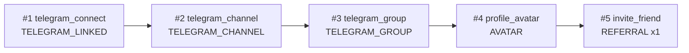

# Сервис: QuickStartAdminService (Admin)

> Общие модели (`biconom.types.QuickStart.*`) и правила программы описаны в
> [`biconom/types/quick_start.md`](../../types/quick_start.md). Здесь — только
> админский сервис.

## 1. Описание

**`QuickStartAdminService`** — админское управление «Быстрым стартом» (Welcome Road).
Четыре зоны ответственности:

1. **Шаблон задач** — создать / обновить / архивировать / удалить задачу
   (`UpsertTask`, `DeleteTask`).
2. **Просмотр программы** — параметры из YAML и шаблон целиком (`GetProgram`).
3. **Поддержка** — засчитать дистрибьютору условие вручную (`FulfillTask`) и посмотреть
   его прохождение так, как видит его он сам (`GetDistributorState`).
4. **Статистика** — воронка по задачам и итоги выплат (`GetStats`).

**Что где редактируется.** Шаблон задач — **здесь**. Параметры программы (`enabled`,
длина окна, финальный бонус, кулдаун проверки) и списки Telegram-каналов и групп
живут в YAML ядра, секция `quick_start:`; через этот сервис они **только читаются**
(`GetProgram`), менять их — деплоем. Подробности — §6.

**Права.** Только `Permission::ROOT`.

## 2. Описание методов (RPC)

### `rpc GetProgram(google.protobuf.Empty) returns (Program)`

- **Назначение**: программа целиком — параметры из YAML и шаблон задач.
- **Возвращаемое значение** (`Program`):

| Поле | Тип | Значение |
|---|---|---|
| `enabled` | `bool` | Программа включена в YAML. При `false` клиенты видят `STATUS_UNAVAILABLE`. |
| `duration_secs` | `uint32` | Длина окна от регистрации, секунды (на проде `86400`). |
| `completion_bonus` | `string` | Финальный бонус, WinTime. |
| `check_cooldown_secs` | `uint32` | Интервал перепроверки одного чата одним дистрибьютором, секунды. |
| `channels` | `repeated TelegramChat` | Telegram-каналы из YAML. |
| `groups` | `repeated TelegramChat` | Telegram-группы из YAML. |
| `tasks` | `repeated Task` | Шаблон задач **без удалённых** (архивные присутствуют). Порядок — обход дерева в глубину по (`position`, `id`). |

- **Ошибки**: только ошибки авторизации (§4).

### `rpc UpsertTask(QuickStart.Task) returns (QuickStart.Task)`

- **Назначение**: создать или обновить задачу шаблона, в том числе **архивировать** и
  **вернуть из архива**.
- **Дискриминатор**: `id == 0` — создать (id назначает сервер и возвращает в ответе);
  `id != 0` — обновить задачу с этим id.
- **Входные параметры** (`QuickStart.Task`):

| Поле | Правила |
|---|---|
| `id` | `0` — создание; иначе id обновляемой задачи. |
| `parent_id` | `0` — корень. Иначе — id существующей задачи; не должен замыкать цикл. |
| `code` | Обязателен. Срезается по краям; допустимы только `[a-z0-9_]`; уникален; не длиннее 64 символов. Фронт выбирает по нему тексты, поэтому переименование нужно согласовывать с фронтом. |
| `condition` | Обязателен (`CONDITION_KIND_UNSPECIFIED` недопустим). |
| `condition_count` | Для `CONDITION_KIND_REFERRAL` — `≥ 1`; для остальных видов — `0`. |
| `reward` | Строка — целое неотрицательное число WinTime (`"2000"`). |
| `position` | Порядок среди задач одного родителя (по возрастанию, затем по `id`). |
| `status` | `STATUS_ACTIVE` / `STATUS_ARCHIVED`. `STATUS_UNSPECIFIED`: при создании — `ACTIVE`, при обновлении статус сохраняется. |

- **Обновление — полная замена полей.** В запросе нужно прислать **все** поля задачи,
  а не только изменяемые: недостающий `parent_id` будет прочитан как `0`, пустой `reward`
  — как ошибка. Безопасная последовательность: `GetProgram` → взять задачу →
  изменить поле → `UpsertTask`.
- **Правило неизменяемости.** `status` и `position` меняются всегда; `code` — если он
  уникален. `parent_id`, `condition`, `condition_count`, `reward` **нельзя менять, если
  по задаче у кого-то есть прогресс** (`FailedPrecondition`, `QUICK_START_TASK_IN_USE`).
  Прогресс появляется, как только хоть один дистрибьютор выполнил условие задачи
  (`FULFILLED` или `COMPLETED`). В таком случае: **архивировать старую задачу и
  создать новую**.
  Повторная отправка тех же значений структурных полей (без изменений) ошибки не даёт.
- **Архивирование** — `status = STATUS_ARCHIVED`, остальные поля без изменений. Эффекты —
  в [`types/quick_start.md`](../../types/quick_start.md), §2.6: новым участникам задача не
  показывается и не входит в условие финального бонуса, закрывшим её остаётся видна,
  дети открываются по ближайшему неархивному предку. Обратимо.
- **Пересчёт.** После `UpsertTask` (и `DeleteTask`) ядро само запускает пересчёт всех
  открытых окон: архивация открывает детей архивной задачи, новая задача возвращает
  «не все закрыты» тем, кто ещё не завершил прохождение. Уже завершившие (`STATUS_COMPLETED`)
  остаются завершившими.
- **Возвращаемое значение**: `QuickStart.Task` после сохранения.
- **Ошибки** (код — в сообщении ошибки):

| Код | gRPC-статус | Когда |
|---|---|---|
| `QUICK_START_TASK_NOT_FOUND` | `NotFound` | Обновление (`id != 0`), но задачи с таким `id` нет |
| `QUICK_START_TASK_NOT_FOUND` | `InvalidArgument` | Нет родителя с таким `parent_id` |
| `QUICK_START_TASK_CYCLE` | `InvalidArgument` | `parent_id` замыкает цикл |
| `QUICK_START_CODE_INVALID` | `InvalidArgument` | `code` пуст, длиннее 64 символов, содержит не `[a-z0-9_]` или уже занят |
| `QUICK_START_CONDITION_INVALID` | `InvalidArgument` | Вид условия не задан, `condition_count` не подходит виду, `reward` не число (или превышает `i64::MAX`), неизвестный `status` |
| `QUICK_START_TASK_IN_USE` | `FailedPrecondition` | Меняются `parent_id` / `condition` / `condition_count` / `reward` у задачи, по которой есть прогресс |

> Один и тот же код `QUICK_START_TASK_NOT_FOUND` приходит с двумя разными gRPC-статусами:
> `NotFound` — нет самой задачи, `InvalidArgument` — нет родителя. Различайте по статусу.

### `rpc DeleteTask(QuickStart.Task.Id) returns (google.protobuf.Empty)`

- **Назначение**: удалить задачу (надгробие; в `GetProgram` она больше не появляется).
- **Входные параметры** (`Task.Id`): `id` (uint32).
- **Правило**: удалить можно только задачу, по которой **ни у кого нет прогресса** и у
  которой **нет детей** (в том числе архивных). Иначе — `FailedPrecondition`
  `QUICK_START_TASK_IN_USE`: задачу нужно архивировать.
- **Ошибки**: `NotFound` (`QUICK_START_TASK_NOT_FOUND`); `FailedPrecondition`
  (`QUICK_START_TASK_IN_USE`).

### `rpc FulfillTask(FulfillTaskRequest) returns (QuickStart.State)`

- **Назначение**: засчитать дистрибьютору условие задачи **вручную** — для поддержки
  (сбой Telegram, спорный случай). Дальше действует обычный путь: если задача открыта,
  награда выплачивается сразу и каскад открывает и оплачивает следующие задачи;
  если закрыта родителем — условие запоминается (`FULFILLED`).
- **Входные параметры** (`FulfillTaskRequest`):
    - `distributor` (`biconom.types.Distributor.Id`): дистрибьютор — любым способом
      идентификации (`id`, `username`, …);
    - `task_id` (uint32): задача шаблона;
    - `reason` (string): **обязательная** причина. Сохраняется в прогрессе и в примечании
      проводки награды.
- **Только в пределах окна**: после закрытия окна ручной зачёт невозможен.
- **Telegram-задачи и `TELEGRAM_STATUS_ALREADY_USED`.** Для задачи с Telegram-условием
  (привязка, канал, группа) ручной зачёт при `ALREADY_USED` засчитывает условие **без
  привязки Telegram-аккаунта**. Это осознанный обход правила «один Telegram — один
  дистрибьютор»: инструмент поддержки, причина (`reason`) обязательна и сохраняется.
- **Побочные эффекты**: при выплате пользователю уходит обычное уведомление о награде
  (`TOPIC_QUICK_START_REWARDED`); в истории кошелька — карточка `quick_start_task_reward`.
  Операция записывается в журнал сервера (админ, дистрибьютор, задача, причина).
  Отменить ручной зачёт нельзя.
- **Возвращаемое значение**: `QuickStart.State` дистрибьютора **после** изменения.
- **Порядок проверок**: причина → дистрибьютор → окно → задача → «уже выполнено».
- **Ошибки**:

| Код | gRPC-статус | Когда |
|---|---|---|
| `QUICK_START_REASON_REQUIRED` | `InvalidArgument` | `reason` пуст (после обрезки пробелов) |
| `DISTRIBUTOR_NOT_FOUND` | `NotFound` | Дистрибьютор не найден |
| `QUICK_START_NOT_ACTIVE` | `FailedPrecondition` | Окно закрыто или программа выключена (также если прохождение уже завершено) |
| `QUICK_START_TASK_NOT_FOUND` | `NotFound` | Нет такой задачи в прохождении этого дистрибьютора (в том числе задача архивная) |
| `QUICK_START_ALREADY_FULFILLED` | `FailedPrecondition` | Условие задачи уже выполнено (`FULFILLED` / `COMPLETED`) |

### `rpc GetDistributorState(biconom.types.Distributor.Id) returns (QuickStart.State)`

- **Назначение**: прохождение дистрибьютора — **то же, что видит он сам** в клиентском
  `Get` (включая `last_check` по Telegram-чатам). Для поддержки.
- **Входные параметры**: `Distributor.Id` (любой способ идентификации).
- **Ошибки**: `NotFound` (`DISTRIBUTOR_NOT_FOUND`).

### `rpc GetStats(google.protobuf.Empty) returns (Stats)`

- **Назначение**: воронка по задачам и итоги выплат.
- **Возвращаемое значение** (`Stats`):

| Поле | Тип | Значение |
|---|---|---|
| `tasks` | `repeated Stats.TaskStats` | Одна запись на каждую задачу шаблона (включая архивные), в порядке шаблона |
| `active_windows` | `uint64` | Окон открыто сейчас (см. примечание ниже) |
| `completed_windows` | `uint64` | Сколько дистрибьюторов получили финальный бонус |
| `completion_bonus_rewarded` | `string` | Выплачено WinTime финальными бонусами |

`Stats.TaskStats`:

| Поле | Тип | Значение |
|---|---|---|
| `task_id` | `uint32` | Задача шаблона |
| `fulfilled` | `uint64` | Выполнили условие (`FULFILLED` + `COMPLETED`) |
| `completed` | `uint64` | Закрыли с наградой |
| `rewarded` | `string` | Выплачено WinTime по задаче (`completed × reward`; награда задачи с прогрессом неизменна) |

> `active_windows` — это число дистрибьюторов, у которых окно ещё не закончилось по
> времени (зарегистрированы менее `duration_secs` назад). Закончившие прохождение досрочно
> в это число входят, пока окно не закроется.

- **Ошибки**: только ошибки авторизации (§4).

## 3. Модель неизменяемости — памятка

| Поле | Всегда можно менять | Нельзя, если у задачи есть прогресс |
|---|---|---|
| `status`, `position` | да | — |
| `code` | да, если уникален (согласовать с фронтом) | — |
| `parent_id`, `condition`, `condition_count`, `reward` | — | `QUICK_START_TASK_IN_USE` → архивировать и создать новую |

## 4. Права доступа и безопасность

- **Требуемые права**: `Permission::ROOT`.
- Токен `Guest` отклоняется (`Unauthenticated`, `GUEST_ACCESS_DENIED`); токен
  `Confirmation` — `PermissionDenied` (`ACCESS_SCOPE_DENIED`). Принимается только
  `Session`-токен с правом `ROOT`.
- Каждая правка шаблона пишет в запись задачи автора (`user_id` админа) и время.

## 5. Сценарии использования

### 5.1. Завести цепочку из пяти задач

Идентификаторы назначает сервер, поэтому цепочка создаётся **последовательно**:
`parent_id` каждой следующей задачи — `id` из ответа на предыдущий вызов. Суммы в примере
условные.



**Шаг 1.** Корень (`parent_id = 0`):

```json
{
  "id": 0,
  "parentId": 0,
  "code": "telegram_connect",
  "condition": "CONDITION_KIND_TELEGRAM_LINKED",
  "conditionCount": 0,
  "reward": "2000",
  "position": 0
}
```

Ответ — задача с назначенным `id`:

```json
{
  "id": 1, "parentId": 0, "code": "telegram_connect",
  "condition": "CONDITION_KIND_TELEGRAM_LINKED", "conditionCount": 0,
  "reward": "2000", "position": 0, "status": "STATUS_ACTIVE"
}
```

**Шаги 2–5.** Каждая следующая — ребёнок предыдущей:

| Шаг | `parent_id` | `code` | `condition` | `condition_count` | `reward` |
|---|---|---|---|---|---|
| 2 | `1` | `telegram_channel` | `CONDITION_KIND_TELEGRAM_CHANNEL` | `0` | `"2000"` |
| 3 | `2` | `telegram_group` | `CONDITION_KIND_TELEGRAM_GROUP` | `0` | `"2000"` |
| 4 | `3` | `profile_avatar` | `CONDITION_KIND_AVATAR` | `0` | `"2000"` |
| 5 | `4` | `invite_friend` | `CONDITION_KIND_REFERRAL` | `1` | `"2000"` |

Например, шаг 5:

```json
{
  "id": 0,
  "parentId": 4,
  "code": "invite_friend",
  "condition": "CONDITION_KIND_REFERRAL",
  "conditionCount": 1,
  "reward": "2000",
  "position": 0
}
```

**Проверка.** `GetProgram` вернёт `tasks` в порядке `#1 … #5`. Задачи `telegram_channel`
и `telegram_group` начнут работать только при непустых списках `channels` / `groups` в
YAML (§6): без чатов условие выполнить нечем.

Если у одного родителя несколько детей (ветвление), их порядок в `State.tasks` задаёт
`position`, затем `id`.

### 5.2. Поменять награду

- Задачу ещё никто не выполнил → `UpsertTask` с новым `reward` (остальные поля — как были).
- Прогресс уже есть → `QUICK_START_TASK_IN_USE`. Нужно архивировать старую задачу
  (`status = STATUS_ARCHIVED`) и создать новую с тем же `parent_id` и нужной наградой.
  Дети старой задачи после этого открываются по ближайшему неархивному предку, то есть
  **минуя** новую задачу (правило 2.6 в [`types/quick_start.md`](../../types/quick_start.md)).
  Чтобы они зависели от новой, их `parent_id` нужно перенацелить на неё — это возможно,
  только пока по ним нет прогресса.

### 5.3. Архивировать и вернуть задачу

`UpsertTask` со всеми полями без изменений и `status = STATUS_ARCHIVED`; обратно —
`status = STATUS_ACTIVE`. Прогресс не затрагивается.

### 5.4. Удалить ошибочно созданную задачу

`DeleteTask`, если никто её не выполнял и у неё нет детей. Иначе — архивировать.

### 5.5. Поддержка: засчитать условие вручную

1. `GetDistributorState` — убедиться, что окно открыто (`STATUS_ACTIVE`), и найти задачу
   (`id`) и её статус.
2. `FulfillTask` с обязательным `reason` (например, «бот не был админом чата»).
3. В ответе — обновлённое `State`: если задача была открыта, она `COMPLETED`, а все
   ранее выполненные дети закрыты каскадом.

Если окно закрыто (`QUICK_START_NOT_ACTIVE`), ручной зачёт невозможен.

### 5.6. Посмотреть эффективность

`GetStats`: по `tasks` строится воронка (`fulfilled` → `completed`), `completed_windows`
и `completion_bonus_rewarded` — итоги финальных бонусов.

## 6. Параметры YAML (только чтение)

Секция `quick_start:` ядра. Через `GetProgram` видны:

| Поле YAML | `Program` | Смысл |
|---|---|---|
| `enabled` | `enabled` | Включение программы |
| `duration` | `duration_secs` | Окно от регистрации (на проде `24h`) |
| `completion_bonus` | `completion_bonus` | Финальный бонус, целые токены WinTime |
| `check_cooldown` | `check_cooldown_secs` | Перепроверка одного чата одним пользователем (на проде `30s`) |
| `channels` | `channels` | Каналы: `telegram_chat_id`, `language`, `title`, `url` |
| `groups` | `groups` | Группы: те же поля |

Что проверяет ядро при старте (ошибка валит запуск): `telegram_chat_id` отрицательный и
уникален среди каналов и групп; `language` — две строчные латинские буквы (ISO 639-1);
`title` не пуст; `url` — ссылка вида `https://t.me/...`.

Эксплуатационные замечания, видные админке:

- Бот должен быть **администратором каждого чата** из списков: иначе Telegram не отдаёт
  ни `getChatMember`, ни события вступления, и членство в этом чате не засчитывается.
  Ядро проверяет это при старте и пишет в лог / метрику.
- Если `completion_bonus` в YAML равен `0`, прохождение всё равно становится
  `STATUS_COMPLETED`, когда закрыты все задачи; бонус просто не начисляется (ни проводки,
  ни уведомления).
- Изменение этих параметров — деплоем (`config.yaml` сервера), не через админку.
