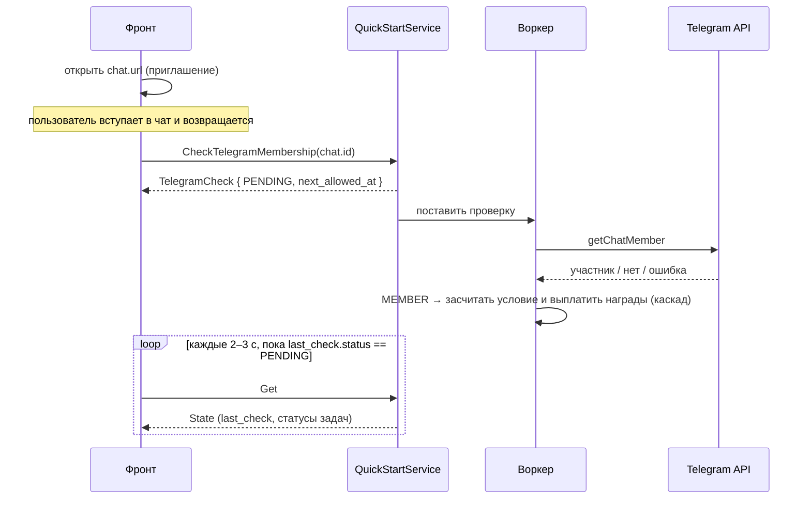

# Сервис: QuickStartService (Client)

> Общие модели (`biconom.types.QuickStart.*`) и правила программы описаны в
> [`biconom/types/quick_start.md`](../../types/quick_start.md). Здесь — только
> клиентский сервис.

## 1. Описание

**`QuickStartService`** — клиентский «Быстрый старт» (Welcome Road): онбординг-задачи
с наградой в WinTime, которые новый дистрибьютор проходит за ограниченное окно (на
проде 24 часа от регистрации). Сервис отдаёт состояние прохождения и умеет запросить
перепроверку членства в Telegram-чате.

**Дистрибьютор** определяется по **контексту авторизации**, не из запроса. Все методы
требуют `Session`-токен.

**Условия засчитывает сервер сам, по событиям**, без участия клиента:

| Событие | Что происходит |
|---|---|
| Привязка Telegram | Засчитывается `telegram_connect`; затем сервер сам проверяет, не состоит ли пользователь уже в чатах открытых задач (мог вступить до привязки) |
| Вступление в канал / группу | Telegram-бот видит вступление в реальном времени (событие `chat_member`) и засчитывает задачу |
| Загрузка аватарки | Засчитывается `profile_avatar` |
| Регистрация личника | Засчитывается / растёт `progress` у `invite_friend` |

То есть **кнопки «получить награду» нет и не нужно**: награда приходит сама, как только
условие выполнено, а задача открыта. `CheckTelegramMembership` — запасной путь на случай,
когда пользователь вступил в чат, а карточка не обновилась.

Награды приходят и как уведомления (`TOPIC_QUICK_START_REWARDED`), и как карточки в
истории кошелька (`quick_start_task_reward`, `quick_start_completion_bonus`) — см.
[`CHANGELOG_2026-10-27.md`](../../../CHANGELOG_2026-10-27.md).

## 2. Описание методов (RPC)

### `rpc Get(google.protobuf.Empty) returns (biconom.types.QuickStart.State)`

- **Назначение**: состояние прохождения быстрого старта текущего дистрибьютора.
- **Входные параметры**: нет.
- **Возвращаемое значение**: `QuickStart.State` — статус окна, `deadline_at`, список
  задач с прогрессом (`tasks`), финальный бонус (`completion_bonus`), статус Telegram
  (`telegram`). Модель — в [`types/quick_start.md`](../../types/quick_start.md), §4.7.
- **После окна** закрытые задачи остаются видны: `Get` работает и при `STATUS_EXPIRED`,
  и при `STATUS_COMPLETED`.
- **Программа выключена** — `State.status = STATUS_UNAVAILABLE`, `tasks` пуст (не
  ошибка).
- **Ошибки**: `NotFound` (`DISTRIBUTOR_NOT_FOUND`) — дистрибьютор не найден; ошибки
  авторизации (см. §5).

### `rpc CheckTelegramMembership(biconom.types.QuickStart.TelegramChat.Id) returns (biconom.types.QuickStart.TelegramCheck)`

- **Назначение**: поставить в очередь проверку членства в Telegram-чате (Telegram
  `getChatMember`). Метод **не ждёт** результата: он возвращает `TelegramCheck` со
  статусом `STATUS_PENDING`, а итог появится в `TaskProgress.last_check` следующих `Get`.
- **Входные параметры** (`TelegramChat.Id`): `id` (int64) — `TelegramChat.id` чата
  из `TaskProgress.chats`, передаётся как есть.
- **Возвращаемое значение** (`TelegramCheck`): `chat_id`, `status = PENDING`,
  `checked_at` (время постановки), `next_allowed_at` (когда можно проверить этот чат
  снова).
- **Результат**: участник → задачи этого вида (канал / группа) становятся `FULFILLED`
  или `COMPLETED`.
- **Проверять можно и задачу, закрытую родителем** (`LOCKED`): выполнение запомнится и
  будет оплачено, когда задача откроется.
- **Порядок проверок** (определяет, какую ошибку получит фронт, если неверно сразу
  несколько условий): дистрибьютор → окно → Telegram привязан / не использован → чат
  найден → условие не выполнено → кулдаун.
- **Ошибки** (код — в сообщении ошибки):

| Код | gRPC-статус | Когда |
|---|---|---|
| `QUICK_START_NOT_ACTIVE` | `FailedPrecondition` | Окно закрыто или программа выключена; также — если прохождение уже завершено (`STATUS_COMPLETED`) |
| `QUICK_START_TELEGRAM_NOT_LINKED` | `FailedPrecondition` | У пользователя не привязан Telegram |
| `QUICK_START_TELEGRAM_ALREADY_USED` | `FailedPrecondition` | Этот Telegram-аккаунт уже засчитывал задачи другому дистрибьютору |
| `QUICK_START_ALREADY_FULFILLED` | `FailedPrecondition` | Условие задачи этого чата уже выполнено |
| `QUICK_START_CHAT_NOT_FOUND` | `NotFound` | В списках каналов / групп нет чата с таким `id` (также, если задачи этого вида в шаблоне нет) |
| `QUICK_START_CHECK_TOO_FREQUENT` | `ResourceExhausted` | С прошлой проверки **этого** чата прошло меньше `check_cooldown` (на проде 30 с) |
| `DISTRIBUTOR_NOT_FOUND` | `NotFound` | Дистрибьютор не найден |

### Диаграмма проверки членства



## 3. Как фронту использовать

### 3.1. Отрисовка карточек

1. Вызвать `Get`. По `State.status`:

| `State.status` | Что показать |
|---|---|
| `STATUS_ACTIVE` | Список карточек и обратный отсчёт до `deadline_at` |
| `STATUS_COMPLETED` | «Пройдено»: бонус `completion_bonus` (если он `"0"` — строку про бонус не показывать), время `completed_at`; карточки закрытых задач остаются |
| `STATUS_EXPIRED` | Закрытые задачи со статусом `COMPLETED`, остальные — «Время вышло». Показывать ли раздел вообще, если ничего не закрыто, решает продукт |
| `STATUS_UNAVAILABLE` | Раздел скрыть |

2. **Карточки рисовать из `State.tasks` в присланном порядке** — это обход дерева в
   глубину по (`position`, `id`). Порядок не пересортировывать.
3. **Тексты и иконку выбирать по `task.code`.** Известные коды: `telegram_connect`,
   `telegram_channel`, `telegram_group`, `profile_avatar`, `invite_friend`. Для
   неизвестного кода нужна запасная карточка (админ может добавить новую задачу
   раньше, чем фронт получит под неё тексты).
4. **Награда карточки** — `task.reward` (строка, целые токены WinTime).
5. **Обратный отсчёт** — до `State.deadline_at`. Когда отсчёт дошёл до нуля, перезапросить
   `Get`: статус окна определяет сервер.
6. **Прогресс**: для `invite_friend` (`CONDITION_KIND_REFERRAL`) — `progress` из
   `task.condition_count`; у остальных видов — `progress` `0` / `1`.

Внешний вид карточки по `TaskProgress.status`:

| Статус | Карточка |
|---|---|
| `LOCKED` | Серая, с замком. Подпись «после «<родитель>»» — по задаче с `id == task.parent_id` из `State.tasks`; если её в списке нет (архивная, вами не закрытая) — только замок без подписи |
| `ACTIVE` | Активная, с кнопкой действия по виду условия |
| `FULFILLED` | «Выполнено, награда придёт после «<родитель>»» — награда ещё **не** выплачена |
| `COMPLETED` | Галочка и «+`reward` WinTime» |
| `EXPIRED` | «Время вышло» |

Действие активной карточки по виду условия (`task.condition`):

| Вид | Кнопка |
|---|---|
| `TELEGRAM_LINKED` | Привязать Telegram (существующий флоу привязки — вне этого сервиса) |
| `TELEGRAM_CHANNEL` / `TELEGRAM_GROUP` | Кнопки чатов, см. §3.2 |
| `AVATAR` | Загрузить аватарку (существующий флоу профиля) |
| `REFERRAL` | Показать реферальную ссылку и счётчик `progress / condition_count` |

### 3.2. Кнопки чатов и проверка членства

- Кнопки строятся из `TaskProgress.chats`: у каждого чата `title`, `language`, `url`
  (ссылка-приглашение). Условие засчитывается за вступление в **любой** из чатов задачи,
  поэтому чат языка интерфейса удобно показать первым, остальные — как альтернативу.
- Кнопки чатов нужны, пока `State.telegram == TELEGRAM_STATUS_LINKED`:
  - `NOT_LINKED` — вместо кнопок предложить привязать Telegram;
  - `ALREADY_USED` — сообщить, что этот Telegram уже использован в быстром старте;
    кнопки проверки не показывать.

Сценарий после перехода в Telegram:

1. Пользователь нажимает кнопку чата → открывается `chat.url`.
2. Пользователь вернулся на сайт (возврат фокуса / кнопка «Я вступил(а)») →
   вызвать `CheckTelegramMembership({ id: chat.id })`.
   Если бот увидел вступление раньше, карточка уже может быть `FULFILLED` / `COMPLETED` —
   поэтому и до вызова стоит обновить `Get`.
3. Ответ — `STATUS_PENDING`. **Опрашивать `Get` каждые 2–3 секунды, пока у задачи
   `last_check.status == STATUS_PENDING`.**
4. По итогу:

| `last_check.status` | Что показать |
|---|---|
| `STATUS_MEMBER` | Условие выполнено; в этом или следующем `Get` задача станет `FULFILLED` / `COMPLETED` (и `last_check` исчезнет) |
| `STATUS_NOT_MEMBER` | «Вас ещё нет в чате» — кнопка проверки снова после `next_allowed_at` |
| `STATUS_FAILED` | «Не удалось проверить, попробуйте позже» (ошибка Telegram API) — кнопка снова после `next_allowed_at` |

5. **Остановить опрос**, как только выполнено любое из условий: `last_check.status` стал
   не `PENDING`; задача вышла из `LOCKED` / `ACTIVE` (`last_check` у такой задачи не
   приходит вовсе); `State.status` больше не `ACTIVE`. На всякий случай опрос стоит
   ограничить по времени: результат проверки хранится только в памяти сервера, и после
   перезапуска ядра ожидающая проверка пропадёт.

**Кулдаун.**

- Не вызывать `CheckTelegramMembership` раньше `next_allowed_at`: иначе
  `QUICK_START_CHECK_TOO_FREQUENT`. Кнопку проверки блокировать до этого момента и
  показывать обратный отсчёт.
- Кулдаун считается **отдельно для каждого чата** от момента запроса проверки. Поле
  `last_check` приходит одно на задачу и описывает **последнюю по времени** проверку среди
  её чатов (`last_check.chat_id` говорит, какую именно). Для остальных чатов задачи свой
  кулдаун держите по `next_allowed_at` из ответов `CheckTelegramMembership`.
- Результат `NOT_MEMBER` / `FAILED` остаётся в `last_check`, пока задача не закрыта или не
  перезапущено ядро.

### 3.3. Когда обновлять состояние

Награды приходят автоматически, поэтому состояние устаревает, не дожидаясь действий
пользователя. Вызывайте `Get`:

- при открытии раздела и при возврате пользователя на вкладку;
- после действий, которые могут закрыть задачу: привязка Telegram, загрузка аватарки,
  вступление в чат;
- по приходу уведомления `TOPIC_QUICK_START_REWARDED` (push / Telegram);
- по таймеру умеренной частоты, пока раздел на экране и окно открыто (`STATUS_ACTIVE`).

Один сигнал может закрыть сразу несколько задач (каскад) — после обновления перерисуйте
весь список, а не одну карточку.

## 4. Награды и баланс

- Награда и финальный бонус зачисляются на кошелёк в **WinTime** (целые токены, строкой).
- В истории кошелька (`TransactionService.History`) — отдельные карточки:
  `quick_start_task_reward` (`task_id`, `task_code`) и `quick_start_completion_bonus`
  (`completed_in_secs`).
- Финальный бонус выплачивается один раз на дистрибьютора. Если он настроен как `0`,
  прохождение всё равно завершается (`STATUS_COMPLETED`), но проводки и уведомления нет.

## 5. Права доступа

- Требуется `Session`-токен обычного пользователя; дистрибьютор — из контекста
  авторизации. Токены `Guest` (`Unauthenticated`, `GUEST_ACCESS_DENIED`) и `Confirmation`
  (`PermissionDenied`, `ACCESS_SCOPE_DENIED`) отклоняются. Сессия без дистрибьютора
  также получает `PermissionDenied` (`ACCESS_SCOPE_DENIED`).
- Отдельного права не требуется: быстрый старт доступен любой пользовательской сессии.

## 6. Полная таблица ошибок

| Код | gRPC-статус | Метод | Когда |
|---|---|---|---|
| `QUICK_START_NOT_ACTIVE` | `FailedPrecondition` | `CheckTelegramMembership` | Окно закрыто, программа выключена или прохождение уже завершено |
| `QUICK_START_TELEGRAM_NOT_LINKED` | `FailedPrecondition` | `CheckTelegramMembership` | Telegram не привязан |
| `QUICK_START_TELEGRAM_ALREADY_USED` | `FailedPrecondition` | `CheckTelegramMembership` | Telegram-аккаунт уже засчитывал задачи другому дистрибьютору |
| `QUICK_START_ALREADY_FULFILLED` | `FailedPrecondition` | `CheckTelegramMembership` | Условие задачи этого чата уже выполнено |
| `QUICK_START_CHAT_NOT_FOUND` | `NotFound` | `CheckTelegramMembership` | Нет чата с таким `id` |
| `QUICK_START_CHECK_TOO_FREQUENT` | `ResourceExhausted` | `CheckTelegramMembership` | Не прошёл `check_cooldown` с прошлой проверки этого чата |
| `DISTRIBUTOR_NOT_FOUND` | `NotFound` | `Get`, `CheckTelegramMembership` | Дистрибьютор не найден |
| `GUEST_ACCESS_DENIED` | `Unauthenticated` | оба | Гостевой токен |
| `ACCESS_SCOPE_DENIED` | `PermissionDenied` | оба | Токен подтверждения или сессия без дистрибьютора |

## 7. Примеры

**Запрос проверки членства** (иллюстрация в proto3 JSON; `int64` — строкой):

```json
{ "id": "-1001111111111" }
```

**Ответ:**

```json
{
  "chatId": "-1001111111111",
  "status": "STATUS_PENDING",
  "checkedAt": "2026-10-27T09:45:02Z",
  "nextAllowedAt": "2026-10-27T09:45:32Z"
}
```

**Фрагмент следующего `Get`, пока проверка в очереди** (`tasks[1]` из примера в
[`types/quick_start.md`](../../types/quick_start.md), §4.8):

```json
{
  "task": { "id": 2, "parentId": 1, "code": "telegram_channel", "condition": "CONDITION_KIND_TELEGRAM_CHANNEL", "reward": "2000", "status": "STATUS_ACTIVE" },
  "status": "STATUS_ACTIVE",
  "chats": [ { "id": "-1001111111111", "language": "ru", "title": "Win2Partners", "url": "https://t.me/win2partners_ru" } ],
  "lastCheck": { "chatId": "-1001111111111", "status": "STATUS_PENDING", "checkedAt": "2026-10-27T09:45:02Z", "nextAllowedAt": "2026-10-27T09:45:32Z" }
}
```

**Тот же фрагмент после успешной проверки** (канал засчитан и оплачен; `last_check`
у закрытой задачи не приходит; `fulfilled_chat_id` показывает, каким чатом засчитано):

```json
{
  "task": { "id": 2, "parentId": 1, "code": "telegram_channel", "condition": "CONDITION_KIND_TELEGRAM_CHANNEL", "reward": "2000", "status": "STATUS_ACTIVE" },
  "status": "STATUS_COMPLETED",
  "fulfilledAt": "2026-10-27T09:45:04Z",
  "completedAt": "2026-10-27T09:45:04Z",
  "chats": [ { "id": "-1001111111111", "language": "ru", "title": "Win2Partners", "url": "https://t.me/win2partners_ru" } ],
  "fulfilledChatId": "-1001111111111",
  "progress": 1
}
```
