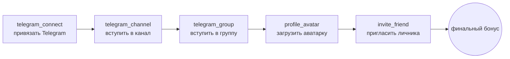
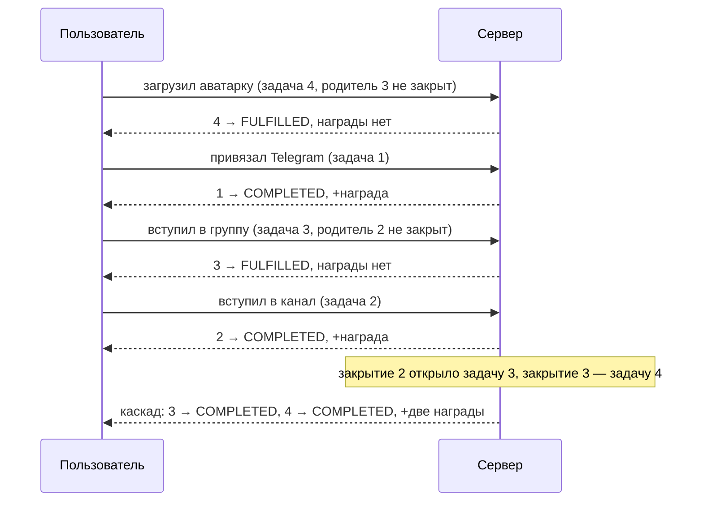
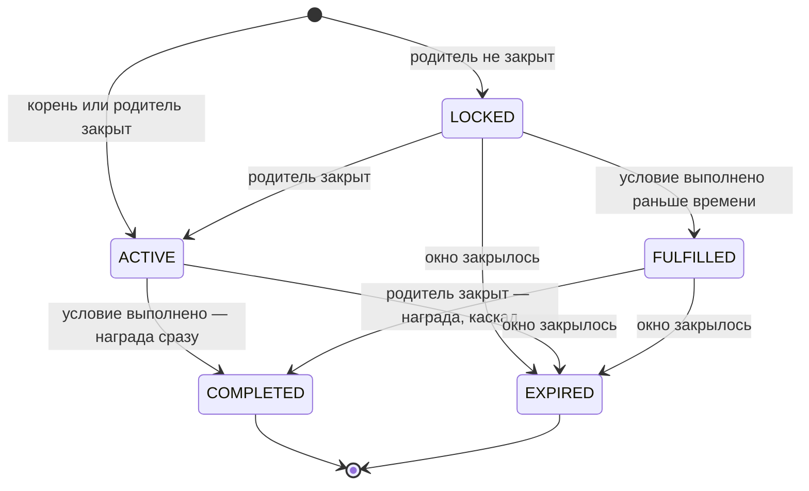

# Модуль: Quick Start («Быстрый старт», Welcome Road)

## 1. Описание

**Быстрый старт** — лес онбординг-задач для нового дистрибьютора с наградой в
**WinTime** за каждую закрытую задачу и **финальным бонусом** за закрытие всех
задач. Прохождение ограничено **окном** — по умолчанию 24 часа от регистрации
дистрибьютора (`duration` в YAML, на проде `24h`).

Пример шаблона (цепочка из пяти задач; коды — те, по которым фронт выбирает тексты и
иконки):



У задачи не более одного родителя (`Task.parent_id`, `0` — корень). Это лес: у
задачи может быть несколько детей, а корней — несколько. Цепочка выше — частный
случай шаблона, а не ограничение модели.

**Где что живёт:**

| Что | Где | Кто меняет |
|---|---|---|
| Шаблон задач (`Task`) | БД ядра | админка, `QuickStartAdminService.UpsertTask` / `DeleteTask` |
| Параметры программы: `enabled`, длина окна, финальный бонус, кулдаун проверки | YAML ядра, секция `quick_start:` | деплой; в админке только чтение (`GetProgram`) |
| Списки Telegram-каналов и групп (`channels`, `groups`) | YAML ядра | деплой; в админке только чтение |
| Тексты и иконки карточек | **фронт**, по `Task.code` | фронт |
| Прогресс дистрибьютора | БД ядра | сервер сам, по событиям; вручную — `FulfillTask` |

Сервер **не хранит и не отдаёт** названия и описания задач — только `code`.

> **Все суммы WinTime — строки** (`Task.reward`, `State.completion_bonus`, суммы в
> статистике): так же, как балансы в `biconom.types.Ledger`. WinTime — валюта
> `WIN_TIME` с `precision 0`, то есть целые токены (`"2000"`, не `"2000.00"`).

## 2. Основные правила

### 2.1. Окно

- Окно: от регистрации дистрибьютора (`created_at`) до `State.deadline_at` =
  регистрация + `duration`.
- Выполнение условия засчитывается, **только если оно наблюдено внутри окна**. Событие,
  случившееся после `deadline_at`, ничего не засчитывает и не оплачивает.
- Окно считается **отдельно у каждого дистрибьютора** (у одного пользователя их может
  быть несколько).
- Если окно дистрибьютора к моменту запроса уже закрылось, его `State.Status =
  EXPIRED`. Это относится и к тем, кто зарегистрировался задолго до запуска программы.
- Программа выключена в YAML (`enabled: false`) — `State.Status = UNAVAILABLE`,
  `State.tasks` пуст.

### 2.2. Условия выполняются в любом порядке

Условие можно выполнить, **не дожидаясь** закрытия родительской задачи.
Выполнение фиксируется сразу (`TaskProgress.fulfilled_at`, статус `FULFILLED`) и
**не снимается**, даже если пользователь потом отменил действие (вышел из канала,
удалил аватарку).

### 2.3. Награда — только когда задача открыта

Награда `Task.reward` выплачивается, когда **одновременно**:

1. условие задачи выполнено, **и**
2. задача открыта — её родитель закрыт (`COMPLETED`) или родителя нет (корень).

Если условие выполнено, а родитель ещё не закрыт, награды пока нет: задача стоит в
`FULFILLED` и ждёт.

### 2.4. Каскад

Закрытие задачи **открывает её детей**. Если условия детей уже выполнены (`FULFILLED`),
они закрываются **тут же**, в том же пересчёте, и открывают своих детей — и так «вниз
до упора». Пользователь видит несколько выплат сразу.



### 2.5. Финальный бонус

`State.completion_bonus` выплачивается **один раз на дистрибьютора**, когда в
пределах окна закрыты **все неархивные** задачи шаблона. В этот момент
`State.Status` становится `COMPLETED`, а `State.completed_at` — моментом завершения
(выплаты бонуса). Если `completion_bonus` равен `0`, прохождение всё равно становится
`COMPLETED`, когда закрыты все задачи: бонус просто не начисляется — ни проводки, ни
уведомления. В
истории кошелька бонус приходит отдельной карточкой с полем `completed_in_secs` —
сколько секунд от регистрации ушло на прохождение.

### 2.6. Архивные задачи

Задача со `Task.Status = ARCHIVED`:

- **не показывается новым участникам** и не входит в условие финального бонуса;
- тем, кто её уже закрыл, остаётся видна (с `COMPLETED`);
- **дети архивной задачи** открываются по её ближайшему неархивному предку (архивная
  задача в цепочке «прозрачна»);
- архивирование **обратимо** (вернуть `STATUS_ACTIVE`).

Поэтому в `State.tasks` архивная задача появляется, только если её закрыл этот
дистрибьютор, и `Task.parent_id` может указывать на задачу, которой в списке нет.

### 2.7. Один Telegram-аккаунт — один дистрибьютор

Награды за Telegram-задачи (привязка, канал, группа) начисляются **не больше одного
раза на Telegram-аккаунт**: первый дистрибьютор, чей Telegram-аккаунт засчитал
Telegram-задачу, «забирает» этот аккаунт. Остальные дистрибьюторы, привязавшие тот же
Telegram, видят `State.telegram = TELEGRAM_STATUS_ALREADY_USED` и Telegram-задачи
выполнить не могут. Условия другого типа (аватарка, личники) выполняются как обычно, но если Telegram-задача
стоит в цепочке выше них, их награда ждёт её закрытия.

### 2.8. Правило неизменяемости шаблона

Пока по задаче **у кого-то есть прогресс** (хотя бы один дистрибьютор выполнил её
условие), поля `parent_id`, `condition`, `condition_count` и `reward` менять нельзя
(`FailedPrecondition`, `QUICK_START_TASK_IN_USE`). Задачу в таком случае
**архивируют и создают новую**. `status`, `position` и `code` менять можно всегда
(`code` — если он уникален).

Удалить задачу можно, только если по ней ни у кого нет прогресса и у неё нет детей.

## 3. Статусы `TaskProgress`



| Статус | Что значит | Что показать | `fulfilled_at` / `completed_at` |
|---|---|---|---|
| `LOCKED` | Родитель не закрыт, условие не выполнено | Серая карточка с замком | нет / нет |
| `ACTIVE` | Задача открыта, условие не выполнено | Активная карточка с действием | нет / нет |
| `FULFILLED` | Условие выполнено, задача всё ещё закрыта родителем; награда придёт при её открытии (в пределах окна) | «Выполнено, награда придёт после «<родитель>»» | есть / нет |
| `COMPLETED` | Задача открыта и выполнена, награда `task.reward` выплачена | Галочка, «+reward WinTime» | есть / есть |
| `EXPIRED` | Окно закрылось до закрытия задачи | «Время вышло» | `fulfilled_at` есть, если условие было выполнено, но награда так и не выплачена; `completed_at` нет |

Нюансы:

- После `deadline_at` **всё незакрытое** становится `EXPIRED` — включая `FULFILLED`:
  награда за неё уже не придёт.
- Переход `ACTIVE → FULFILLED` в норме не встречается: открытая задача с выполненным
  условием сразу оплачивается и становится `COMPLETED`. `FULFILLED` у задачи с уже
  закрытым родителем возможен лишь как временное состояние при сбое проводки; выплата
  будет повторена при ближайшем событии по этому дистрибьютору.
- Переход `LOCKED → ACTIVE` фронт видит только при следующем `Get`.

## 4. Модели (`biconom.types.QuickStart`)

### 4.1. `ConditionKind` — вид условия

Значения append-only: новый вид добавляется в конец.

| Значение | Условие | `Task.condition_count` | Как засчитывается автоматически |
|---|---|---|---|
| `CONDITION_KIND_TELEGRAM_LINKED` (1) | Привязан собственный Telegram-аккаунт | `0` | в момент привязки Telegram |
| `CONDITION_KIND_TELEGRAM_CHANNEL` (2) | Состоит в **любом** канале из YAML-списка `channels` | `0` | бот видит вступление в чат; после привязки Telegram сервер сам проверяет, не состоит ли пользователь уже в чатах; запасной путь — `CheckTelegramMembership` |
| `CONDITION_KIND_TELEGRAM_GROUP` (3) | Состоит в **любой** группе из YAML-списка `groups` | `0` | так же, как для канала |
| `CONDITION_KIND_AVATAR` (4) | Загружена аватарка профиля | `0` | при загрузке аватарки |
| `CONDITION_KIND_REFERRAL` (5) | Пригласил по своей ссылке не меньше `condition_count` прямых личников, зарегистрированных **после начала окна** | `≥ 1` | при регистрации личника |

`CONDITION_KIND_UNSPECIFIED` (0) — не используется; в шаблоне вид обязателен
(`QUICK_START_CONDITION_INVALID`).

### 4.2. `Task` — задача шаблона

| Поле | Тип | Значение |
|---|---|---|
| `id` | `uint32` | Стабильный идентификатор, назначает сервер. |
| `parent_id` | `uint32` | Блокирующая задача; `0` — корень (открыта с начала окна). |
| `code` | `string` | Slug для фронта — по нему выбираются тексты и иконка карточки. Уникален, `[a-z0-9_]`. |
| `condition` | `ConditionKind` | Вид условия. |
| `condition_count` | `uint32` | Порог: для `REFERRAL` — сколько личников (≥ 1); для остальных видов `0`. |
| `reward` | `string` | Награда в WinTime за закрытие задачи (целые токены). |
| `position` | `uint32` | Порядок среди задач одного родителя (по возрастанию, затем по `id`). |
| `status` | `Task.Status` | `STATUS_ACTIVE` (1) — видна и открывается участникам; `STATUS_ARCHIVED` (2) — в архиве (см. 2.6). |

Вспомогательные вложенные сообщения: `Task.Id { id }` (для `DeleteTask`) и
`Task.List { items }`.

**Известные коды** (тексты и иконки для них должны быть на фронте):

| `code` | Вид условия | Карточка |
|---|---|---|
| `telegram_connect` | `TELEGRAM_LINKED` | Привязать Telegram |
| `telegram_channel` | `TELEGRAM_CHANNEL` | Вступить в канал |
| `telegram_group` | `TELEGRAM_GROUP` | Вступить в группу |
| `profile_avatar` | `AVATAR` | Загрузить аватарку |
| `invite_friend` | `REFERRAL` | Пригласить друга |

Для неизвестного `code` нужна запасная карточка: админ вправе завести новую задачу
раньше, чем фронт получит под неё тексты.

### 4.3. `TelegramChat` — канал или группа из YAML

| Поле | Тип | Значение |
|---|---|---|
| `id` | `int64` | Telegram `chat_id`. У каналов и супергрупп **отрицательный**, вида `-100…`. Именно его передают в `CheckTelegramMembership`. |
| `language` | `string` | Язык чата, ISO 639-1 (`ru`, `en`, …). |
| `title` | `string` | Название для карточки. |
| `url` | `string` | Ссылка-приглашение (`https://t.me/...`). |

`TelegramChat.Id { id }` — запрос `CheckTelegramMembership`. Передавать нужно значение
`id` из `TaskProgress.chats` как есть, не пересобирая из строки.

В списке чатов задачи — **все** чаты данного вида на всех языках. Условие засчитывается
за вступление в **любой** из них, поэтому фронт обычно показывает чат языка интерфейса
первым, остальные — как альтернативу.

### 4.4. `TelegramStatus` — Telegram пользователя глазами быстрого старта

Значения append-only. Приходит в `State.telegram`.

| Значение | Смысл | Что делать фронту |
|---|---|---|
| `TELEGRAM_STATUS_NOT_LINKED` (1) | Telegram не привязан — задачи Telegram выполнить нельзя | В карточках Telegram-задач предложить привязать Telegram (существующий флоу привязки); `CheckTelegramMembership` вернёт `QUICK_START_TELEGRAM_NOT_LINKED` |
| `TELEGRAM_STATUS_LINKED` (2) | Привязан и может засчитывать задачи | Всё работает |
| `TELEGRAM_STATUS_ALREADY_USED` (3) | Привязан, но этот Telegram-аккаунт уже засчитывал задачи быстрого старта другому дистрибьютору | Сообщить, что Telegram уже использован; кнопки проверки не показывать. Если Telegram-задача — родитель других (как в цепочке из пяти задач), дети остаются закрытыми; помочь может только поддержка (`FulfillTask`) |

Перепроверка членства доступна **только** при `TELEGRAM_STATUS_LINKED`.

### 4.5. `TelegramCheck` — последняя перепроверка членства

Хранится **только в памяти сервера** (перезапуск ядра её стирает — это безвредно).

| Поле | Тип | Значение |
|---|---|---|
| `chat_id` | `int64` | `TelegramChat.id` проверенного чата. |
| `status` | `TelegramCheck.Status` | См. ниже. |
| `checked_at` | `Timestamp` | Время проверки. Пока проверка `PENDING`, это время постановки в очередь. |
| `next_allowed_at` | `Timestamp` | Раньше этого момента повторная проверка **этого** чата отклоняется (`check_cooldown` из YAML, на проде 30 с). Отсчитывается от момента запроса проверки. |

`TelegramCheck.Status` (значения append-only):

| Значение | Смысл |
|---|---|
| `STATUS_PENDING` (1) | В очереди воркера |
| `STATUS_MEMBER` (2) | Участник — условие выполнено |
| `STATUS_NOT_MEMBER` (3) | Не участник |
| `STATUS_FAILED` (4) | Не удалось проверить (ошибка Telegram API) |

### 4.6. `TaskProgress` — задача глазами дистрибьютора

| Поле | Тип | Значение |
|---|---|---|
| `task` | `Task` | Задача шаблона (архивная — только если закрыта этим дистрибьютором). |
| `status` | `TaskProgress.Status` | См. раздел 3. |
| `fulfilled_at` | `Timestamp` | Когда зафиксировано выполнение условия (нет — не выполнено). |
| `completed_at` | `Timestamp` | Когда выплачена награда (нет — не выплачена). |
| `chats` | `repeated TelegramChat` | Чаты на выбор — **только для задач канала / группы**; у остальных пуст. |
| `fulfilled_chat_id` | `int64` | Чат, которым засчитано условие (`TelegramChat.id`); `0` — не засчитано (или засчитано не чатом: вручную, или не чат-задача). |
| `last_check` | `optional TelegramCheck` | Последняя перепроверка по чатам этой задачи, если была. Приходит только у незакрытых задач (`LOCKED` / `ACTIVE`) с чатами. |
| `progress` | `uint32` | Текущее значение условия. Для `REFERRAL` — сколько личников уже пришло в окне (цель — `task.condition_count`); для остальных видов — `0` (не выполнено) или `1` (выполнено), цель `1`. |

### 4.7. `State` — прохождение дистрибьютора

| Поле | Тип | Значение |
|---|---|---|
| `status` | `State.Status` | См. ниже. |
| `deadline_at` | `Timestamp` | Конец окна = регистрация + `duration`. |
| `tasks` | `repeated TaskProgress` | Неархивные задачи + архивные, закрытые этим дистрибьютором. **Порядок — обход дерева в глубину по (`position`, `id`)**: рисовать карточки именно в этом порядке. |
| `completion_bonus` | `string` | Финальный бонус за закрытие всех неархивных задач, WinTime. |
| `completed_at` | `Timestamp` | Когда завершено прохождение и выплачен финальный бонус (только при `STATUS_COMPLETED`). |
| `telegram` | `TelegramStatus` | Telegram пользователя (см. 4.4). |

`State.Status` (значения append-only):

| Значение | Смысл |
|---|---|
| `STATUS_ACTIVE` (1) | Окно открыто |
| `STATUS_COMPLETED` (2) | Все неархивные задачи закрыты в окне, финальный бонус выплачен (при `completion_bonus = 0` — просто не начисляется) |
| `STATUS_EXPIRED` (3) | Окно закрылось (в том числе у зарегистрированных до запуска) |
| `STATUS_UNAVAILABLE` (4) | Программа выключена в YAML; `tasks` пуст |

### 4.8. Пример `State` (иллюстрация в proto3 JSON)

Дистрибьютор привязал Telegram и загрузил аватарку; канал ещё не засчитан. Награда
за аватарку не выплачена — задача закрыта родителем (`telegram_group`), поэтому она в
`FULFILLED`.

```json
{
  "status": "STATUS_ACTIVE",
  "deadlineAt": "2026-10-28T09:30:00Z",
  "completionBonus": "10000",
  "telegram": "TELEGRAM_STATUS_LINKED",
  "tasks": [
    {
      "task": { "id": 1, "parentId": 0, "code": "telegram_connect", "condition": "CONDITION_KIND_TELEGRAM_LINKED", "conditionCount": 0, "reward": "2000", "position": 0, "status": "STATUS_ACTIVE" },
      "status": "STATUS_COMPLETED",
      "fulfilledAt": "2026-10-27T09:41:10Z",
      "completedAt": "2026-10-27T09:41:10Z",
      "progress": 1
    },
    {
      "task": { "id": 2, "parentId": 1, "code": "telegram_channel", "condition": "CONDITION_KIND_TELEGRAM_CHANNEL", "conditionCount": 0, "reward": "2000", "position": 0, "status": "STATUS_ACTIVE" },
      "status": "STATUS_ACTIVE",
      "chats": [
        { "id": "-1001111111111", "language": "ru", "title": "Win2Partners", "url": "https://t.me/win2partners_ru" },
        { "id": "-1002222222222", "language": "en", "title": "Win2Partners", "url": "https://t.me/win2partners" }
      ],
      "lastCheck": { "chatId": "-1001111111111", "status": "STATUS_NOT_MEMBER", "checkedAt": "2026-10-27T09:45:02Z", "nextAllowedAt": "2026-10-27T09:45:32Z" },
      "progress": 0
    },
    {
      "task": { "id": 3, "parentId": 2, "code": "telegram_group", "condition": "CONDITION_KIND_TELEGRAM_GROUP", "conditionCount": 0, "reward": "2000", "position": 0, "status": "STATUS_ACTIVE" },
      "status": "STATUS_LOCKED",
      "chats": [
        { "id": "-1003333333333", "language": "ru", "title": "Чат новичков", "url": "https://t.me/win2partners_chat_ru" }
      ],
      "progress": 0
    },
    {
      "task": { "id": 4, "parentId": 3, "code": "profile_avatar", "condition": "CONDITION_KIND_AVATAR", "conditionCount": 0, "reward": "2000", "position": 0, "status": "STATUS_ACTIVE" },
      "status": "STATUS_FULFILLED",
      "fulfilledAt": "2026-10-27T09:43:00Z",
      "progress": 1
    },
    {
      "task": { "id": 5, "parentId": 4, "code": "invite_friend", "condition": "CONDITION_KIND_REFERRAL", "conditionCount": 1, "reward": "2000", "position": 0, "status": "STATUS_ACTIVE" },
      "status": "STATUS_LOCKED",
      "progress": 0
    }
  ]
}
```

JSON — иллюстрация канонического proto3 JSON (`int64` — строкой, `Timestamp` — ISO-8601,
enum — именем). Реальный клиент работает со сгенерированными типами; суммы в примере
условные. Поля с нулевым значением в JSON опущены.

## 5. Связанные сущности

| Что | Где |
|---|---|
| Клиентский сервис `QuickStartService` | [`biconom/client/quick_start/quick_start.md`](../client/quick_start/quick_start.md) |
| Админский сервис `QuickStartAdminService` | [`biconom/admin/quick_start/quick_start.md`](../admin/quick_start/quick_start.md) |
| Карточки в истории кошелька | `Transaction.Group.Entry.details`: `quick_start_task_reward` (34), `quick_start_completion_bonus` (35) — см. [`CHANGELOG_2026-10-27.md`](../../CHANGELOG_2026-10-27.md) |
| Уведомление о награде | `TOPIC_QUICK_START_REWARDED` (23) в `notification_preferences` |
| Баланс WinTime | валюта `WIN_TIME`, `precision 0`; модели — `biconom/types/ledger.proto` |

## 6. Права доступа

- Клиентский `QuickStartService` — `Session`-токен обычного пользователя; дистрибьютор —
  из контекста авторизации.
- Админский `QuickStartAdminService` — `Permission::ROOT`.
